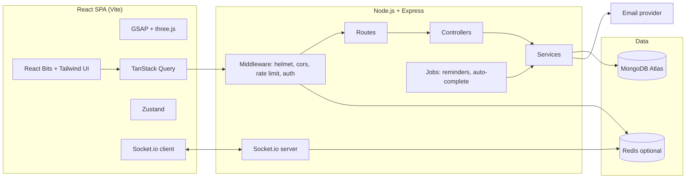

# Architecture

## 1. Overview

SkillSwap is a MERN application with a REST API for request/response work and Socket.io for real-time messaging and notifications. The backend is a modular monolith: one deployable service, internally split into feature modules with clear boundaries so it can be split later if needed.



## 2. Frontend Architecture

| Concern | Decision |
|---|---|
| Build | Vite + React 18 |
| Routing | React Router with route-level code splitting |
| Server state | TanStack Query (caching, retries, invalidation) |
| Client state | Zustand (auth user, UI flags, socket status) |
| Forms | React Hook Form + Zod resolver |
| Styling | Tailwind CSS with CSS variable tokens (see DESIGN_SYSTEM.md) |
| Components | React Bits (copied into `src/components/reactbits`), custom primitives in `src/components/ui` |
| Motion | GSAP via `useGSAP`; three.js via `@react-three/fiber` (lazy loaded) |
| Icons | `@phosphor-icons/react` |

### Layers

1. **Pages**: route-level screens, compose features.
2. **Features**: self-contained slices (`auth`, `profile`, `matching`, `sessions`, `wallet`, `reviews`, `chat`).
3. **Components**: shared UI primitives and React Bits wrappers.
4. **Lib**: API client, socket client, motion helpers, utilities.

Features never import from each other directly. They communicate through shared hooks, query keys or the store.

## 3. Backend Architecture

Request flow:

```
Request -> helmet/cors -> rate limiter -> body parser -> auth -> validate (Zod)
        -> controller -> service -> model -> response -> error handler
```

| Layer | Responsibility | Rules |
|---|---|---|
| Routes | URL + middleware wiring | No logic |
| Controllers | Parse request, call service, shape response | No DB calls |
| Services | Business rules, transactions | Only place that touches models |
| Models | Mongoose schemas, indexes | No business logic beyond validation |
| Middleware | Auth, validation, errors, rate limits | Reusable and stateless |
| Jobs | Scheduled work | Idempotent |

### Modules

| Module | Owns |
|---|---|
| `auth` | Register, login, refresh, logout, email verification, password reset |
| `users` | Account, profile, availability, blocking |
| `skills` | Skill taxonomy, search, suggestions |
| `matching` | Match scoring and recommendation feed |
| `sessions` | Booking lifecycle and state machine |
| `wallet` | Credit ledger, escrow holds, balance |
| `reviews` | Ratings and reputation aggregates |
| `chat` | Conversations, messages, read receipts |
| `notifications` | In-app and email notifications |
| `reports` | User reports and moderation queue |

## 4. Real-Time Layer

- Socket.io on the same Express HTTP server.
- Authentication at handshake using the access token from the cookie or `auth` payload.
- Rooms: `user:{id}` for personal events, `conv:{id}` for chat.
- When running more than one instance, add the Redis adapter.

Events are listed in API.md.

## 5. Background Jobs

| Job | Trigger | Action |
|---|---|---|
| Session reminder | 24h and 1h before start | Notification + email |
| Request expiry | Pending request older than 72h | Mark `expired`, release hold |
| Auto-complete | 24h after end time with no dispute | Release credits to teacher |
| Token cleanup | Daily | Remove expired refresh tokens |

Start with `node-cron`. Move to BullMQ + Redis when running multiple instances so jobs run once.

## 6. Key Data Flows

### Sign up
1. Client posts email and password.
2. Server hashes password, creates user and wallet, writes a `SIGNUP_BONUS` ledger entry in one transaction.
3. Verification email sent. Access and refresh cookies are set.

### Match to booking
1. Client requests `/matches`.
2. Matching service scores candidates and returns a ranked list.
3. Learner opens a profile and sends a session request.
4. Server validates balance, places a credit hold, creates session in `requested`.
5. Teacher accepts, session moves to `scheduled`, both get notifications.
6. After the session, both confirm completion. Hold is released to the teacher.
7. Both users are prompted to rate.

## 7. Error Handling

- Central error middleware maps errors to a consistent shape:

```json
{ "success": false, "error": { "code": "INSUFFICIENT_CREDITS", "message": "Not enough credits", "details": [] } }
```

- Operational errors use a typed `AppError`. Unknown errors return a generic 500 and are logged with a request id.

## 8. Observability

- Structured logs with `pino`, request id on every line.
- `/health` (liveness) and `/ready` (DB connectivity).
- Error tracking (Sentry) on client and server.
- Metrics to watch: p95 latency, 5xx rate, ledger transaction failures, socket connections.

## 9. Architectural Decisions

| Decision | Reason |
|---|---|
| Modular monolith | Right size for a student/startup team, simple deploys |
| Ledger over mutable balance | Auditable, easy to debug, resists abuse |
| Escrow holds | Protects both learner and teacher |
| Cookies for tokens | HttpOnly cookies are safer than localStorage against XSS |
| Lazy-loaded three.js | Keeps the initial bundle small |
