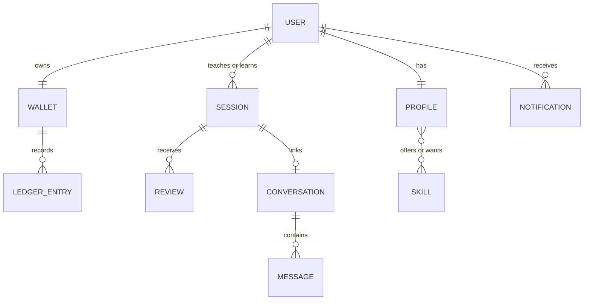

# Database Design

MongoDB Atlas (replica set, required for transactions). ODM: Mongoose.

## 1. Collections Overview

| Collection | Purpose |
|---|---|
| `users` | Account, auth fields, role, status |
| `profiles` | Public profile, skills offered and wanted, availability |
| `skills` | Normalized skill taxonomy |
| `sessions` | Booked lessons |
| `wallets` | Cached balance and held credits |
| `ledgerEntries` | Immutable credit movements |
| `reviews` | Ratings per session |
| `conversations` | Chat threads |
| `messages` | Chat messages |
| `notifications` | In-app notifications |
| `refreshTokens` | Hashed refresh tokens with rotation |
| `reports` | User reports for moderation |
| `auditLogs` | Admin action trail |

## 2. Relationships



## 3. Schemas

### users

```js
const userSchema = new Schema({
  email:         { type: String, required: true, unique: true, lowercase: true, trim: true },
  passwordHash:  { type: String, required: true, select: false },
  name:          { type: String, required: true, trim: true, maxlength: 80 },
  role:          { type: String, enum: ['user', 'admin'], default: 'user' },
  status:        { type: String, enum: ['active', 'suspended', 'deleted'], default: 'active' },
  emailVerified: { type: Boolean, default: false },
  verifyTokenHash: { type: String, select: false },
  resetTokenHash:  { type: String, select: false },
  resetTokenExp:   { type: Date, select: false },
  failedLogins:  { type: Number, default: 0 },
  lockUntil:     { type: Date },
  blockedUserIds: [{ type: Schema.Types.ObjectId, ref: 'User' }],
  lastActiveAt:  { type: Date, default: Date.now },
}, { timestamps: true });
```

### profiles

```js
const profileSchema = new Schema({
  userId:    { type: Schema.Types.ObjectId, ref: 'User', unique: true, required: true },
  headline:  { type: String, maxlength: 120 },
  bio:       { type: String, maxlength: 1000 },
  avatarUrl: String,
  timezone:  { type: String, default: 'Asia/Kolkata' },
  languages: [String],
  offered: [{
    skillId: { type: Schema.Types.ObjectId, ref: 'Skill', required: true },
    level:   { type: String, enum: ['beginner', 'intermediate', 'advanced', 'expert'] },
    note:    { type: String, maxlength: 200 },
  }],
  wanted: [{
    skillId: { type: Schema.Types.ObjectId, ref: 'Skill', required: true },
    level:   { type: String, enum: ['beginner', 'intermediate', 'advanced'] },
  }],
  // denormalized for fast matching
  offeredSkillIds: [{ type: Schema.Types.ObjectId, index: true }],
  wantedSkillIds:  [{ type: Schema.Types.ObjectId, index: true }],
  availability: [{
    day:       { type: Number, min: 0, max: 6 },   // 0 = Sunday
    startMin:  { type: Number, min: 0, max: 1439 }, // minutes from midnight, user's timezone
    endMin:    { type: Number, min: 1, max: 1440 },
  }],
  stats: {
    ratingAvg:      { type: Number, default: 0 },
    ratingCount:    { type: Number, default: 0 },
    sessionsTaught: { type: Number, default: 0 },
    sessionsLearned:{ type: Number, default: 0 },
    medianResponseMin: Number,
  },
}, { timestamps: true });
```

### skills

```js
const skillSchema = new Schema({
  name:     { type: String, required: true, unique: true },
  slug:     { type: String, required: true, unique: true },
  aliases:  [String],
  category: { type: String, index: true },
  status:   { type: String, enum: ['approved', 'pending'], default: 'approved' },
});
skillSchema.index({ name: 'text', aliases: 'text' });
```

### sessions

```js
const sessionSchema = new Schema({
  teacherId: { type: Schema.Types.ObjectId, ref: 'User', required: true, index: true },
  learnerId: { type: Schema.Types.ObjectId, ref: 'User', required: true, index: true },
  skillId:   { type: Schema.Types.ObjectId, ref: 'Skill', required: true },
  title:     { type: String, maxlength: 120 },
  message:   { type: String, maxlength: 500 },
  startsAt:  { type: Date, required: true },          // UTC
  durationMin: { type: Number, enum: [30, 60, 90], required: true },
  creditMin: { type: Number, required: true },        // equals durationMin by default
  meetingUrl: String,
  status: {
    type: String,
    enum: ['requested','scheduled','in_progress','completed','disputed','settled','declined','expired','cancelled'],
    default: 'requested', index: true,
  },
  confirmations: { teacher: Boolean, learner: Boolean },
  cancelledBy: { type: Schema.Types.ObjectId, ref: 'User' },
  cancelReason: String,
  version: { type: Number, default: 0 },              // optimistic concurrency
}, { timestamps: true });
sessionSchema.index({ teacherId: 1, startsAt: 1 });
sessionSchema.index({ learnerId: 1, startsAt: 1 });
```

### wallets

```js
const walletSchema = new Schema({
  userId:  { type: Schema.Types.ObjectId, ref: 'User', unique: true, required: true },
  balance: { type: Number, default: 0, min: 0 },   // credit minutes
  held:    { type: Number, default: 0, min: 0 },
  earnedToday: { type: Number, default: 0 },
  earnedDay:   { type: String },                   // YYYY-MM-DD, resets daily cap
}, { timestamps: true });
```

### ledgerEntries

```js
const ledgerSchema = new Schema({
  walletId:  { type: Schema.Types.ObjectId, ref: 'Wallet', required: true, index: true },
  userId:    { type: Schema.Types.ObjectId, ref: 'User', required: true, index: true },
  sessionId: { type: Schema.Types.ObjectId, ref: 'Session' },
  type: { type: String, enum: ['SIGNUP_BONUS','HOLD','RELEASE_OUT','RELEASE_IN','REFUND','ADJUSTMENT'], required: true },
  amount: { type: Number, required: true },        // credit minutes, always positive
  direction: { type: String, enum: ['credit','debit','hold','unhold'], required: true },
  idempotencyKey: { type: String, required: true, unique: true },
  reason: String,
  createdBy: { type: Schema.Types.ObjectId, ref: 'User' },
}, { timestamps: { createdAt: true, updatedAt: false } });
```

Guard against updates by not exposing any update/delete method in the repository and by using a restricted database role in production.

### reviews

```js
const reviewSchema = new Schema({
  sessionId:  { type: Schema.Types.ObjectId, ref: 'Session', required: true },
  reviewerId: { type: Schema.Types.ObjectId, ref: 'User', required: true },
  revieweeId: { type: Schema.Types.ObjectId, ref: 'User', required: true, index: true },
  rating:     { type: Number, min: 1, max: 5, required: true },
  tags:       [String],
  comment:    { type: String, maxlength: 500 },
  visible:    { type: Boolean, default: false },
}, { timestamps: true });
reviewSchema.index({ sessionId: 1, reviewerId: 1 }, { unique: true });
```

### conversations and messages

```js
const conversationSchema = new Schema({
  participants: [{ type: Schema.Types.ObjectId, ref: 'User', index: true }],
  sessionId:    { type: Schema.Types.ObjectId, ref: 'Session' },
  lastMessage:  { text: String, at: Date, senderId: Schema.Types.ObjectId },
  lastReadAt:   { type: Map, of: Date },
}, { timestamps: true });
conversationSchema.index({ participants: 1, updatedAt: -1 });

const messageSchema = new Schema({
  conversationId: { type: Schema.Types.ObjectId, ref: 'Conversation', required: true },
  senderId: { type: Schema.Types.ObjectId, ref: 'User', required: true },
  text:     { type: String, required: true, maxlength: 2000 },
}, { timestamps: { createdAt: true, updatedAt: false } });
messageSchema.index({ conversationId: 1, createdAt: -1 });
```

### notifications

```js
const notificationSchema = new Schema({
  userId: { type: Schema.Types.ObjectId, ref: 'User', required: true },
  type:   String,
  data:   Schema.Types.Mixed,
  readAt: Date,
}, { timestamps: { createdAt: true, updatedAt: false } });
notificationSchema.index({ userId: 1, createdAt: -1 });
notificationSchema.index({ createdAt: 1 }, { expireAfterSeconds: 60 * 60 * 24 * 90 }); // TTL 90 days
```

### refreshTokens

```js
const refreshTokenSchema = new Schema({
  userId:    { type: Schema.Types.ObjectId, ref: 'User', index: true },
  tokenHash: { type: String, required: true, unique: true },
  family:    { type: String, index: true },   // for reuse detection
  expiresAt: { type: Date, required: true },
  revokedAt: Date,
  userAgent: String,
  ip:        String,
});
refreshTokenSchema.index({ expiresAt: 1 }, { expireAfterSeconds: 0 });
```

## 4. Transaction Example (request a session)

```js
const session = await mongoose.startSession();
await session.withTransaction(async () => {
  const wallet = await Wallet.findOneAndUpdate(
    { userId: learnerId, $expr: { $gte: [{ $subtract: ['$balance', '$held'] }, creditMin] } },
    { $inc: { held: creditMin } },
    { new: true, session }
  );
  if (!wallet) throw new AppError('INSUFFICIENT_CREDITS', 402);

  const [created] = await Session.create([{ /* ... */ }], { session });

  await LedgerEntry.create([{
    walletId: wallet._id, userId: learnerId, sessionId: created._id,
    type: 'HOLD', direction: 'hold', amount: creditMin,
    idempotencyKey: `hold:${created._id}`,
  }], { session });
});
```

## 5. Index Summary

| Collection | Index | Reason |
|---|---|---|
| users | `email` unique | Login lookup |
| profiles | `offeredSkillIds`, `wantedSkillIds` | Matching queries |
| sessions | `(teacherId, startsAt)`, `(learnerId, startsAt)` | Dashboards, conflict checks |
| ledgerEntries | `idempotencyKey` unique | Retry safety |
| reviews | `(sessionId, reviewerId)` unique | One review per person per session |
| messages | `(conversationId, createdAt)` | Pagination |
| notifications | TTL on `createdAt` | Auto cleanup |

## 6. Data Retention

- Messages: kept while the conversation exists, deleted on account deletion.
- Ledger: retained permanently for auditability, personal fields anonymized on account deletion.
- Notifications: 90 days.
- Refresh tokens: removed on expiry.
