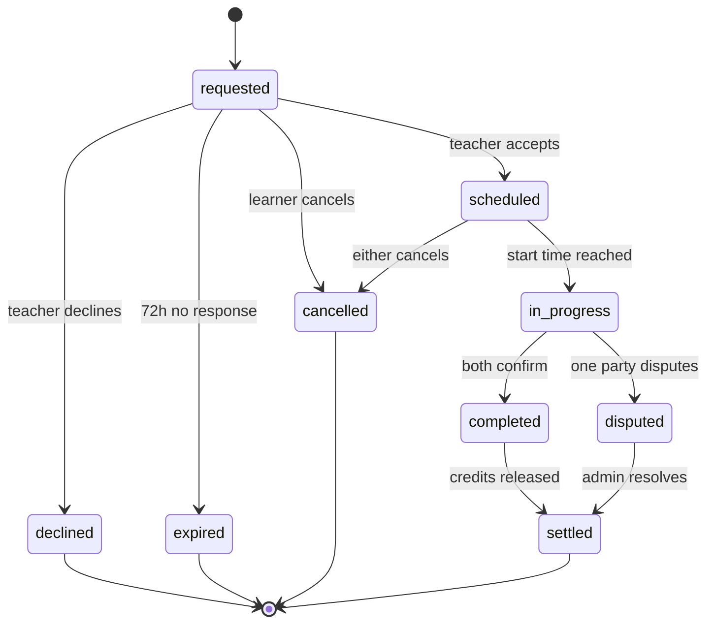

# System Design

## 1. Requirements

### Functional

1. Users register, verify email and sign in.
2. Users build a skill profile: skills offered, skills wanted, level, availability, timezone.
3. The system recommends matches using two-way skill compatibility.
4. A learner can request a session with a teacher for a chosen duration.
5. Credits move through a wallet with escrow during a session.
6. Both participants rate each other after a completed session.
7. Matched or booked users can message in real time.

### Non-Functional

| Area | Target |
|---|---|
| Availability | 99.5% for a first release |
| API latency | p95 under 300 ms for reads, under 600 ms for booking |
| Consistency | Credit operations are strongly consistent and idempotent |
| Security | See SECURITY.md |
| Scale (v1) | Up to ~50k users, ~2k concurrent socket connections |
| Accessibility | WCAG 2.1 AA, reduced-motion support |

### Out of Scope for v1

Video calling (sessions use an external meeting link), payments, native mobile apps.

## 2. Credit Model

Credits are measured in **credit minutes** internally. One hour of teaching equals 60 credit minutes. The UI shows hours (for example, 2.5 credits).

| Rule | Default (configurable) |
|---|---|
| Earn | 1 minute taught = 1 credit minute |
| Spend | 1 minute learned = 1 credit minute |
| Signup bonus | 180 credit minutes (3 hours) so new users can learn first |
| Session durations | 30, 60, 90 minutes |
| Minimum balance to request | Must cover the full session |
| Daily earn cap | 480 credit minutes per user (anti-farming) |

### Ledger (source of truth)

Every movement is an immutable ledger entry. The wallet document stores a cached `balance` and `held` updated in the same transaction.

| Entry type | Effect |
|---|---|
| `SIGNUP_BONUS` | + to learner wallet |
| `HOLD` | learner `available` decreases, `held` increases |
| `RELEASE` | held amount leaves learner, + to teacher |
| `REFUND` | held amount returns to learner `available` |
| `ADJUSTMENT` | admin correction with reason |

```
available = balance - held
```

Rules:
1. All wallet writes run inside a MongoDB transaction.
2. Every entry carries an `idempotencyKey` (unique index), so retries never double-charge.
3. Entries are never updated or deleted. Corrections are new entries.
4. A nightly job verifies `wallet.balance == sum(ledger)` and alerts on drift.

## 3. Session State Machine



| Transition | Credit action |
|---|---|
| `requested` created | `HOLD` full amount |
| `declined`, `expired`, `cancelled` by learner early | `REFUND` full |
| `cancelled` by teacher | `REFUND` full, teacher reliability score decreases |
| `cancelled` by learner under 2h before start | `REFUND` 50%, 50% released to teacher |
| `completed` | `RELEASE` to teacher |
| `disputed` | Hold stays until admin resolution |

Auto-complete: if neither party disputes within 24 hours after the end time, the session completes and credits are released.

## 4. Matching Algorithm

Matching returns a ranked list for the current user.

**Candidate pool:** users who teach at least one skill the current user wants, verified email, not blocked, active in the last 30 days.

**Score (0 to 100):**

```
score = 0.40 * skillFit
      + 0.25 * reciprocity
      + 0.15 * availabilityOverlap
      + 0.15 * reputation
      + 0.05 * responsiveness
```

| Component | Definition |
|---|---|
| `skillFit` | Share of the user's wanted skills the candidate teaches, weighted by level match |
| `reciprocity` | Whether the candidate wants something the user teaches (bonus for mutual swap) |
| `availabilityOverlap` | Overlapping weekly hours after timezone normalization |
| `reputation` | Bayesian average rating, so one 5-star review does not outrank many 4.8s |
| `responsiveness` | Median time to respond to requests |

Implementation notes:
- Query with the aggregation pipeline using indexed `offeredSkillIds` and `wantedSkillIds`.
- Compute scores in the service layer for the top ~200 candidates, return a page.
- Cache each user's feed for 5 minutes, invalidate when their profile changes.
- Skills use a normalized taxonomy (`skills` collection) with aliases to avoid "JS" vs "JavaScript" splits.

## 5. Ratings and Reputation

- Only participants of a `completed` or `settled` session can review, once per session per person.
- Rating 1 to 5, optional comment (max 500 chars), tags such as `clear`, `patient`, `punctual`.
- Reviews are hidden until both submit or 7 days pass, to reduce retaliation bias.
- Bayesian average: `(C * m + sum) / (C + n)` where `m` is the global mean and `C` is a prior weight (for example 5).

## 6. Messaging

- A conversation is created automatically when a session request is sent.
- Messages: text only in v1, max 2000 chars.
- Delivery: Socket.io push, persisted in MongoDB first, then emitted.
- Read receipts via `lastReadAt` per participant.
- Block and report actions are available in every conversation.

## 7. Notifications

| Event | In-app | Email |
|---|---|---|
| Session requested | Yes | Yes |
| Accepted / declined | Yes | Yes |
| Reminder 24h / 1h | Yes | Yes |
| Credits received | Yes | No |
| New message while offline | Yes | Digest only |
| Review reminder | Yes | Yes |

## 8. Scaling Plan

| Stage | Change |
|---|---|
| v1 | Single Node instance, Atlas M10, in-memory rate limit |
| Growth | 2+ instances, Redis for rate limits and Socket.io adapter, BullMQ for jobs |
| Later | Read replicas for feed queries, search via Atlas Search, split `chat` into its own service |

Caching:
- Skill taxonomy: in-memory with 1h TTL.
- Match feed: Redis (or in-memory in v1), 5 min TTL.
- Public profiles: HTTP cache headers with short `max-age`.

## 9. Failure Modes and Edge Cases

| Scenario | Handling |
|---|---|
| Double-click on "Request session" | Idempotency key per request |
| Server crash mid-transaction | Transaction aborts, nothing partial persists |
| Both users cancel simultaneously | First committed transition wins, second gets `409` |
| Teacher no-show | Learner reports, session disputed, admin refunds |
| Timezone confusion | Store UTC, display in each user's timezone, show both in booking UI |
| Credit farming via fake accounts | See SECURITY.md section 7 |
| User deletes account with held credits | Block deletion until open sessions settle |

## 10. Admin and Moderation

- Admin role can view reports, resolve disputes, suspend users and post `ADJUSTMENT` entries with a mandatory reason.
- Every admin action is written to an `auditLogs` collection.
